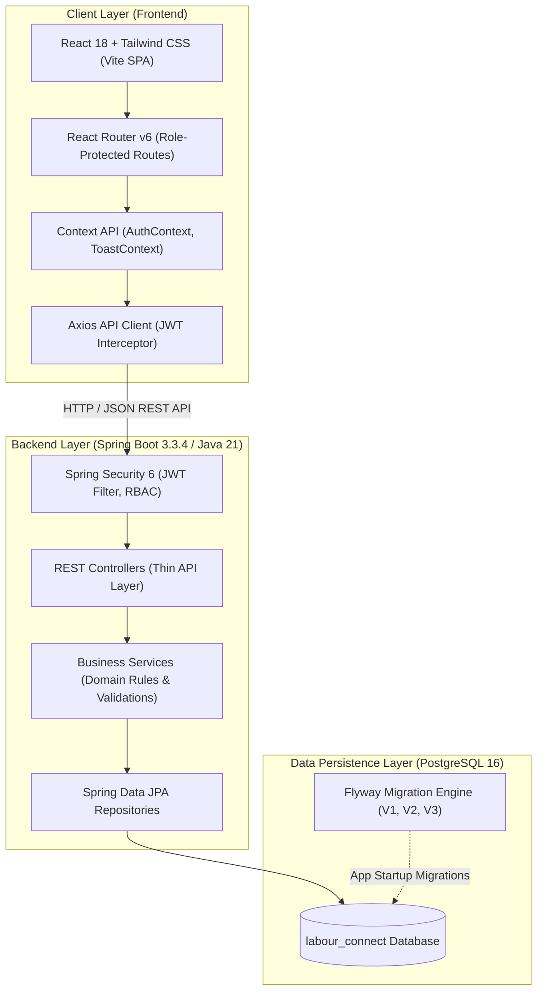
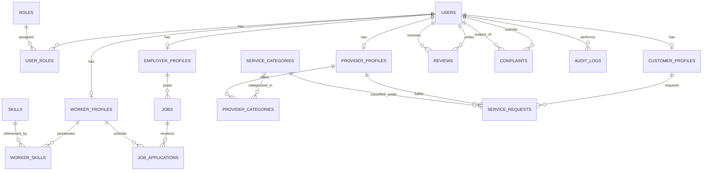

# Labour Connect — Digital Platform for Skilled Employment and On-Demand Local Services

Labour Connect is a full-stack web application designed to connect daily-wage and regular skilled workers, employers/shopkeepers, local customers, and verified on-demand service providers within communities.

---

## 1. System Architecture

The project is structured as a clean, modular full-stack application:

```
LabourConnectProject/
├── backend/          # Java 21 + Spring Boot 3.3.4 REST API
│   ├── src/main/java/com/labourconnect/
│   │   ├── config/       # Security, CORS, Swagger, Database seed runner
│   │   ├── controller/   # REST Controllers (/api/v1/*)
│   │   ├── dto/          # Data Transfer Objects & Validation
│   │   ├── entity/       # JPA Hibernate Entities
│   │   ├── exception/    # Custom Exception Hierarchy & Global Handler
│   │   ├── repository/   # Spring Data JPA Repositories
│   │   ├── security/     # JWT Token Provider, Auth Filter, SecurityConfig
│   │   └── service/      # Business logic & transaction workflows
│   ├── src/main/resources/
│   │   ├── application.yml   # Spring Boot application configuration
│   │   └── db/migration/     # Flyway SQL migrations (V1, V2, V3)
│   ├── src/test/java/com/labourconnect/ # Automated unit & integration tests
│   ├── pom.xml           # Maven project descriptor
│   ├── .env              # Backend runtime environment configuration
│   └── .env.example      # Environment variables template
├── frontend/         # React 18 + Vite + Tailwind CSS SPA
│   ├── src/
│   │   ├── components/   # Reusable UI components (Navbar, Modal, Button, etc.)
│   │   ├── context/      # AuthContext (JWT) and ToastContext (alerts)
│   │   ├── features/     # Domain feature modules (admin, employers, workers, etc.)
│   │   ├── layouts/      # MainLayout (public) and DashboardLayout (sidebar)
│   │   ├── pages/        # Public pages (Home, Login, Register, Terms, Privacy)
│   │   ├── routes/       # AppRoutes and ProtectedRoute (RBAC)
│   │   ├── services/     # Axios client with JWT interceptor
│   │   ├── styles/       # Tailwind CSS base styles
│   │   └── utils/        # Constants, formats, and badges
│   ├── index.html        # HTML entry point
│   ├── package.json      # Dependencies and npm scripts
│   ├── vite.config.js    # Vite bundler configuration
│   ├── .env              # Frontend API base URL & Google Client ID
│   └── .env.example      # Environment variables template
├── database/         # PostgreSQL setup and backup scripts
│   ├── init-db.sql       # Database creation script
│   ├── setup-db.ps1      # Automated database initialization script
│   ├── backup-db.ps1     # Automated pg_dump backup script
│   └── restore-db.ps1    # Database restoration script
├── .gitignore        # Standard Git ignore rules
└── README.md         # Complete project documentation & guide
```

### Architectural Data Flow



---

## 2. Core Modules & User Roles

Labour Connect operates through two main modules:

### A. Employment Connect
1. **Daily Wage Employment**: Hiring skilled labor (masons, carpenters, painters, helpers) on daily rates.
2. **Contract Employment**: Project-based hiring for specific milestones and budgets.
3. **Regular Employment**: Long-term regular hiring for retail salesmen, shop assistants, cashiers, office assistants, and general helpers with monthly salary ranges (`₹/month`) and defined working hours.

### B. On-Demand Service Connect
- Connects local households and businesses with verified professionals for on-demand services:
  - **Plumbing**, **Electrical**, **Carpentry**, **House Painting**, **Cleaning**, **Appliance Repair**.
  - Service request lifecycle: `REQUESTED` → `ACCEPTED` → `ON_THE_WAY` → `SERVICE_STARTED` → `COMPLETED`.

---

### The Five User Roles
| Role | Authority | Key Capabilities |
| :--- | :--- | :--- |
| **Admin** | `ROLE_ADMIN` | Platform governance, provider verification approval/rejection, service catalog management, dispute resolution, security audit logs. |
| **Employer** | `ROLE_EMPLOYER` | Post daily wage, contract, or regular jobs; review applicant bids; shortlist, hire, or reject workers; rate worker performance. |
| **Worker** | `ROLE_WORKER` | Manage profile and skills; browse jobs with filters; submit applications/bids; track application progress. |
| **Customer** | `ROLE_CUSTOMER` | Browse verified service providers; book on-demand service requests; track live status; rate providers; raise complaints. |
| **Service Provider** | `ROLE_PROVIDER` | Manage service categories and pricing; receive customer requests; progress request statuses; submit credentials for verified badge. |

---

## 3. Database Entity-Relationship Model



---

## 4. Technology Stack

- **Frontend**: React 18, Vite 5, Tailwind CSS 3.4, React Router v6, Axios, Lucide Icons, Google Identity Services OAuth 2.0.
- **Backend**: Java 21, Spring Boot 3.3.4, Spring Security 6 (stateless JWT), Spring Data JPA, Hibernate, Flyway Migration, Jakarta Bean Validation.
- **Database**: PostgreSQL 16 on `localhost:5432`, database: `labour_connect`.
- **API Documentation**: OpenAPI 3.0 / Swagger UI (`/swagger-ui.html`).
- **Build Tools**: Apache Maven 3.9.6 (bundled in `.tools/apache-maven-3.9.6/`), Node.js v18+ / npm.

---

## 5. Local Setup & Running Instructions

### Step 1: PostgreSQL Database Initialization
Ensure PostgreSQL is running locally on port 5432.
Run the database initializer script:
```powershell
# From the project root
.\database\setup-db.ps1
```
*(Or manually in psql: `psql -U postgres -h localhost -p 5432 -f database/init-db.sql`)*

### Step 2: Environment Configuration
The project comes pre-configured with local development defaults:
- **`backend/.env`**:
  ```env
  SERVER_PORT=8081
  DB_URL=jdbc:postgresql://localhost:5432/labour_connect
  DB_USERNAME=postgres
  DB_PASSWORD=your_actual_postgres_password
  JWT_SECRET=super_secret_labour_connect_jwt_key_must_be_at_least_32_characters_long_for_hmac256
  JWT_EXPIRATION_MS=86400000
  CORS_ALLOWED_ORIGINS=http://localhost:5173,http://127.0.0.1:5173
  ```
- **`frontend/.env`**:
  ```env
  VITE_API_BASE_URL=http://localhost:8081/api/v1
  ```

### Step 3: Start the Backend (Spring Boot)
```powershell
# From the project root
cd backend
..\.tools\apache-maven-3.9.6\bin\mvn.cmd spring-boot:run
```
*Flyway automatically applies all database schema migrations (`V1__init_schema.sql`, `V2__seed_reference_data.sql`, `V3__add_regular_employment_support.sql`), and sample test accounts are provisioned on first boot.*

The backend REST API will be available at: `http://localhost:8081/api/v1`
Swagger API Documentation: `http://localhost:8081/swagger-ui.html`

### Step 4: Start the Frontend (React + Vite)
In a separate terminal:
```powershell
cd frontend
npm install
npm run dev
```
Open **[http://localhost:5173](http://localhost:5173)** in your browser.

---

## 6. Pre-Configured Demo Accounts

The database includes verified test accounts for each role:

| Role | Email Address | Password | Description |
| :--- | :--- | :--- | :--- |
| **System Admin** | `admin@labourconnect.com` | `Admin@1234` | Governance, dispute resolution, provider verification |
| **Employer** | `employer@labourconnect.com` | `Employer@1234` | Apex Construction & Hardware Stores (active jobs) |
| **Skilled Worker** | `worker@labourconnect.com` | `Worker@1234` | Suresh Sharma (Masonry, General Labour) |
| **Customer** | `customer@labourconnect.com` | `Customer@1234` | Anita Sharma (Residential homeowner) |
| **Service Provider** | `provider@labourconnect.com` | `Provider@1234` | Ramesh Electrician (Verified Badge) |

---

## 7. REST API Reference Overview

Base URL: `http://localhost:8081/api/v1`

| Category | Method | Endpoint | Description | Role Required |
| :--- | :--- | :--- | :--- | :--- |
| **Auth** | `POST` | `/auth/register` | Register new user account | Public |
| | `POST` | `/auth/login` | Authenticate; returns JWT access token | Public |
| | `POST` | `/auth/google` | Google OAuth 2.0 Sign-In / Sign-Up | Public |
| | `GET` | `/auth/me` | Fetch authenticated user details | Authenticated |
| **Profiles** | `GET/PUT` | `/profiles/worker` | Worker headline, skills, wage rates | `ROLE_WORKER` |
| | `GET/PUT` | `/profiles/employer` | Employer company, contact info | `ROLE_EMPLOYER` |
| | `GET/PUT` | `/profiles/provider` | Provider categories, pricing, radius | `ROLE_PROVIDER` |
| | `GET/PUT` | `/profiles/customer` | Customer address and location | `ROLE_CUSTOMER` |
| **Jobs** | `GET` | `/jobs` | Search & filter jobs (`jobType`, `query`, `city`, `minWage`) | Public |
| | `GET` | `/jobs/{id}` | View detailed job posting | Public |
| | `POST` | `/jobs` | Post new job (Daily Wage, Contract, Regular) | `ROLE_EMPLOYER` |
| | `PUT` | `/jobs/{id}` | Update job details | `ROLE_EMPLOYER` (Owner) |
| | `DELETE` | `/jobs/{id}` | Close or cancel job | `ROLE_EMPLOYER` (Owner) |
| | `GET` | `/jobs/my-jobs` | Employer's posted jobs | `ROLE_EMPLOYER` |
| | `GET` | `/jobs/{id}/applications` | View applicants for a job | `ROLE_EMPLOYER` (Owner) |
| | `POST` | `/jobs/{id}/apply` | Apply for a job | `ROLE_WORKER` |
| | `GET` | `/jobs/applications/my-applications` | Worker's application history | `ROLE_WORKER` |
| | `PUT` | `/jobs/applications/{id}/status` | Accept, shortlist, or reject applicant | `ROLE_EMPLOYER` (Owner) |
| **Services** | `GET` | `/categories` | List active service categories | Public |
| | `GET` | `/services/providers` | Discover nearby service providers | Public |
| | `POST` | `/services/requests` | Book an on-demand service | `ROLE_CUSTOMER` |
| | `GET` | `/services/requests/customer` | Customer's bookings history | `ROLE_CUSTOMER` |
| | `GET` | `/services/requests/provider` | Provider's incoming service jobs | `ROLE_PROVIDER` |
| | `PUT` | `/services/requests/{id}/status` | Transition service request status | Assigned Provider / Customer |
| **Trust** | `POST` | `/reviews` | Submit star rating and feedback | Authenticated |
| | `POST` | `/complaints` | Submit formal dispute complaint | Authenticated |
| **Admin** | `GET` | `/admin/dashboard` | Platform metrics & statistics | `ROLE_ADMIN` |
| | `GET` | `/admin/users` | Manage user activation/suspension | `ROLE_ADMIN` |
| | `GET` | `/admin/providers/pending` | Review pending provider verifications | `ROLE_ADMIN` |
| | `PUT` | `/admin/providers/{id}/decision` | Approve / reject provider verification | `ROLE_ADMIN` |
| | `GET` | `/admin/audit-logs` | Security and governance audit trail | `ROLE_ADMIN` |

---

## 8. Automated Tests & Build Verification

### Backend Automated Test Suite
```powershell
cd backend
..\.tools\apache-maven-3.9.6\bin\mvn.cmd test
```
*Runs comprehensive JUnit 5 and Spring Boot integration test suites covering authentication, job posting, regular employment validation, on-demand dispatch lifecycles, and reviews (10 tests run, 0 failures, 0 errors).*

### Frontend Production Build Verification
```powershell
cd frontend
npm run build
```
*Validates zero JSX/syntax errors, Tailwind tree-shaking, and builds production static bundle in `frontend/dist/`.*

---

## 9. Database Backup and Recovery

Automated PowerShell scripts are located directly under `database/`:
```powershell
# Create a logical backup using pg_dump
.\database\backup-db.ps1

# Restore from a backup archive
.\database\restore-db.ps1 -BackupFile ".\database\backups\labour_connect_YYYYMMDD_HHMMSS.sql"
```
