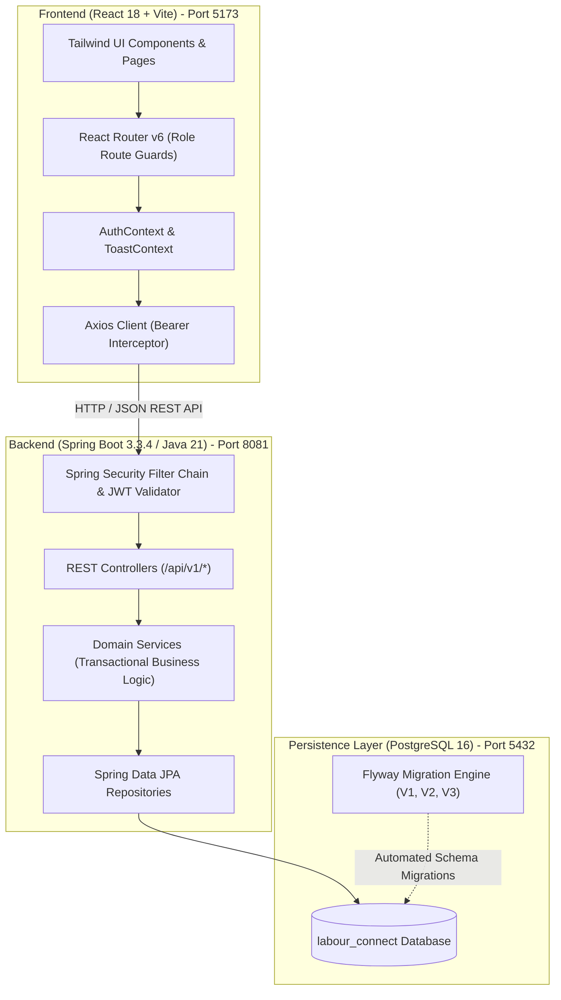
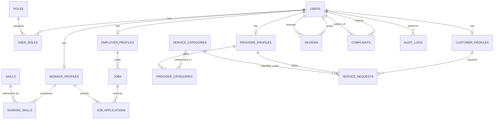

# Labour Connect — Web Platform for Skilled Employment and On-Demand Local Services

Labour Connect is a full-stack web application developed for localized job discovery and community service fulfillment. The platform connects daily wage workers, contractors, and long-term retail/commercial employees with employers, while simultaneously enabling local households and businesses to book verified on-demand service professionals (plumbers, electricians, carpenters, painters, and technicians).

---

## 1. Project Modules

The application is structured into two primary modules:

### A. Employment Connect
Focuses on flexible and regular workforce hiring:
- **Daily Wage Employment**: Short-term hiring for construction, masonry, painting, carpentry, and general manual labour paid on a daily rate (`₹/day`).
- **Contract Employment**: Project-based hiring for specific milestones, estimated durations, and fixed contract wages.
- **Regular Employment**: Long-term hiring for retail salesmen, shop assistants, showroom cashiers, office assistants, and general helpers with defined monthly salary ranges (`₹/month`) and working hours/shifts.
- **Key Features**:
  - Employers post jobs with detailed descriptions, compensation, location (city/area), and required skill tags.
  - Workers browse open jobs with multi-criteria filters (keyword search, city, employment type, and wage/salary range).
  - Workers submit applications with customized bids/expected compensation and cover notes.
  - Employers review applicants, inspect experience and ratings, and advance application statuses (`APPLIED` → `SHORTLISTED` → `ACCEPTED` / `REJECTED`).
  - Workers can track application progression or withdraw pending applications.
  - Employers can search a directory of registered skilled workers by skill, city, and availability.

### B. On-Demand Service Connect
Connects customers with verified local service professionals:
- **Service Categories**: Plumbing, Electrical, Carpentry, House Painting, Cleaning, and Appliance Repair.
- **Provider Profiles**: Providers configure hourly rates, service areas, experience, and offered categories.
- **Structured Lifecycle State Machine**:
  $$\text{REQUESTED} \longrightarrow \text{ACCEPTED} \longrightarrow \text{ON\_THE\_WAY} \longrightarrow \text{SERVICE\_STARTED} \longrightarrow \text{COMPLETED}$$
  *(or `CANCELLED` by either party before work begins)*
- **Quality & Trust**:
  - Customers submit 1–5 star ratings and reviews upon service completion.
  - Formal dispute and complaint filing system with administrative mediation.
  - Providers upload credentials to request an official Administrative Verification Badge.

---

## 2. User Roles & Capabilities

The application implements Role-Based Access Control (RBAC) across five user roles:

| Role | Authority | Key Responsibilities & Implemented Features |
| :--- | :--- | :--- |
| **Admin** | `ROLE_ADMIN` | • System governance overview with real-time database counts.<br>• User account management: activate or suspend accounts with reason logging.<br>• Provider verification: inspect submitted provider credentials, approve or reject badges.<br>• Service category catalog management: create, update, and toggle active categories.<br>• Dispute resolution: inspect user complaints and record resolution outcomes.<br>• Security audit log: view tamper-evident records of administrative actions. |
| **Employer** | `ROLE_EMPLOYER` | • Manage business profile (Individual, Shopkeeper, Contractor, Enterprise).<br>• Post job openings (Daily Wage, Contract, or Regular Employment).<br>• Manage active, closed, and completed job postings.<br>• Review applicant bids, experience, and skills; shortlist, hire, or reject candidates.<br>• Browse directory of skilled workers by skill and location.<br>• Rate worker performance upon job completion. |
| **Worker** | `ROLE_WORKER` | • Maintain worker profile: bio, years of experience, daily rate, hourly rate, location.<br>• Select skills from the platform taxonomy.<br>• Set availability status (`AVAILABLE`, `BUSY`, `UNAVAILABLE`).<br>• Search and filter job postings by type, salary/wage, and location.<br>• Submit applications with expected wage/salary and cover notes.<br>• Track application status and view employer ratings. |
| **Customer** | `ROLE_CUSTOMER` | • Manage residential/business address and contact information.<br>• Browse service categories and discover nearby verified service providers.<br>• Book on-demand services with scheduled dates, addresses, and issue notes.<br>• Track live request status updates from dispatch to completion.<br>• Rate completed service requests and submit dispute complaints. |
| **Service Provider** | `ROLE_PROVIDER` | • Manage professional profile: hourly rates, service radius, and experience.<br>• Select service categories offered.<br>• Request administrative verification for the verified badge.<br>• Receive incoming service requests and progress their lifecycle statuses.<br>• View earned customer ratings and reviews. |

---

## 3. Implemented Job Types

1. **Daily Wage (`DAILY_WAGE`)**:
   - Intended for day-to-day skilled labour (masons, carpenters, painters, helpers).
   - Compensation: Daily rate in Indian Rupees (e.g., `₹850/day`).
   - Work duration measured in estimated days.
2. **Contract (`CONTRACT`)**:
   - Intended for short-term project contracts and renovations.
   - Compensation: Total or milestone contract wage.
   - Work duration measured in project days with defined start dates.
3. **Regular Employment (`REGULAR`)**:
   - Intended for retail and commercial positions (shop salesmen, counter assistants, showroom cashiers, office assistants, warehouse helpers) hired on an ongoing basis for months or years.
   - Compensation: Monthly salary range (`minMonthlySalary` and `maxMonthlySalary`, e.g., `₹18,000 - ₹24,000/mo`).
   - Shift & Working Hours: Structured string field (e.g., `10:00 AM - 8:30 PM (6 days/week)`).
   - Display: Displays a distinctive "Regular Employment" badge, monthly salary range, and working hours pill on all job cards and dashboards.
   - Compatibility: Automatically derives an equivalent daily wage (`minMonthlySalary / 26`) to preserve sorting, wage filtering, and legacy reporting.

---

## 4. Technology Stack

### Frontend
- **Framework**: React 18 (`18.3.1`)
- **Build Tool**: Vite 5 (`5.4.6`)
- **Routing**: React Router DOM v6 (`6.26.2`) with role-protected route guards
- **Styling**: Tailwind CSS 3 (`3.4.11`), PostCSS (`8.4.47`), Autoprefixer
- **HTTP Client**: Axios (`1.7.7`) with automatic JWT bearer request interceptors
- **Icons**: Lucide React (`0.441.0`)
- **Authentication**: JWT local storage + Google Identity Services SDK for Google OAuth 2.0 Web Sign-In

### Backend
- **Language**: Java 21 LTS
- **Framework**: Spring Boot 3.3.4
- **Security**: Spring Security 6 (stateless session, JWT filter, method-level `@PreAuthorize` RBAC)
- **Persistence**: Spring Data JPA & Hibernate 6.5.3
- **Validation**: Jakarta Bean Validation (`spring-boot-starter-validation`)
- **Migrations**: Flyway 10 (`flyway-core`, `flyway-database-postgresql`)
- **JWT**: JJWT 0.12.5 (`jjwt-api`, `jjwt-impl`, `jjwt-jackson`)
- **Google Auth**: Google API Client (`GoogleIdTokenVerifier`)
- **API Documentation**: SpringDoc OpenAPI 2.6.0 (Swagger UI)
- **Testing**: JUnit 5, Mockito, AssertJ, Spring Boot Test, H2 In-Memory Database

### Database
- **Engine**: PostgreSQL 16
- **Database Name**: `labour_connect`
- **Default Port**: `5432`

---

## 5. System Architecture & Entity Model

### Architecture Diagram



### Database Entity-Relationship Model



---

## 6. Project Folder Structure

```
LabourConnectProject/
├── backend/                              # Java Spring Boot backend
│   ├── src/
│   │   ├── main/
│   │   │   ├── java/com/labourconnect/
│   │   │   │   ├── config/               # Security, CORS, Swagger, Seed Runner
│   │   │   │   ├── controller/           # 12 REST API Controllers (/api/v1/*)
│   │   │   │   ├── dto/                  # Request & Response DTOs with validation
│   │   │   │   ├── entity/               # 14 JPA Hibernate Entities
│   │   │   │   ├── exception/            # Custom Exceptions & Global Exception Handler
│   │   │   │   ├── repository/           # 14 Spring Data JPA Repositories
│   │   │   │   ├── security/             # JWT Filter, Token Provider, UserPrincipal
│   │   │   │   └── service/              # Transactional business logic & services
│   │   │   └── resources/
│   │   │       ├── application.yml       # Application properties & configuration
│   │   │       └── db/migration/         # Flyway SQL migrations (V1, V2, V3)
│   │   └── test/java/com/labourconnect/  # JUnit 5 & Spring Boot test classes
│   ├── pom.xml                           # Maven dependencies & build configuration
│   ├── .env                              # Local backend environment configuration
│   └── .env.example                      # Backend environment variable template
├── frontend/                             # React SPA frontend
│   ├── src/
│   │   ├── components/common/            # Reusable UI components (Navbar, Modal, Card, Button, etc.)
│   │   ├── context/                      # AuthContext (JWT session) & ToastContext (notifications)
│   │   ├── features/                     # Feature domain views (admin, jobs, workers, etc.)
│   │   ├── layouts/                      # MainLayout (public) & DashboardLayout (authenticated sidebar)
│   │   ├── pages/                        # Public pages (Home, Login, Register, Terms, Privacy)
│   │   ├── routes/                       # AppRoutes & ProtectedRoute (RBAC navigation)
│   │   ├── services/                     # Axios API service client
│   │   ├── styles/                       # Tailwind CSS global styles
│   │   └── utils/                        # Constants, compensation formatters, badge helpers
│   ├── public/                           # Static assets (favicon.svg)
│   ├── index.html                        # HTML root template
│   ├── package.json                      # Frontend dependencies & npm scripts
│   ├── vite.config.js                    # Vite configuration
│   ├── tailwind.config.js                # Tailwind CSS design system configuration
│   ├── postcss.config.js                 # PostCSS configuration
│   ├── .env                              # Local frontend environment configuration
│   └── .env.example                      # Frontend environment variable template
├── database/                             # PostgreSQL initialization & administration
│   ├── init-db.sql                       # Database creation SQL script
│   ├── setup-db.ps1                      # PowerShell database initializer
│   ├── backup-db.ps1                     # Logical pg_dump backup script
│   └── restore-db.ps1                    # Database restore script
├── .tools/                               # Portable Apache Maven 3.9.6 for Windows
├── .gitignore                            # Git exclusion rules
└── README.md                             # Project documentation
```

---

## 7. Installation & Running Instructions (Windows)

### Prerequisites
1. **Java Runtime**: JDK 21 (Microsoft OpenJDK 21 or Eclipse Temurin 21).
2. **Node.js**: v18+ or v20+ with `npm`.
3. **PostgreSQL**: PostgreSQL 15 or 16 running locally on port `5432`.
4. **Maven**: Apache Maven 3.9+ (or use the portable Maven bundled in `.tools\apache-maven-3.9.6\bin\mvn.cmd`).

---

### Step 1: Initialize the PostgreSQL Database
Make sure the PostgreSQL service is running locally on port 5432.
Run the PowerShell setup script from the project root:
```powershell
.\database\setup-db.ps1
```
*(Alternatively, execute `psql -U postgres -h localhost -p 5432 -f database/init-db.sql` in Command Prompt or pgAdmin).*

---

### Step 2: Configure Environment Variables

1. **Backend (`backend/.env`)**:
   Create or verify `backend/.env` based on `backend/.env.example`:
   ```env
   SERVER_PORT=8081
   DB_URL=jdbc:postgresql://localhost:5432/labour_connect
   DB_USERNAME=postgres
   DB_PASSWORD=<your_local_postgres_password>
   JWT_SECRET=<your_secure_random_key_at_least_32_characters>
   JWT_EXPIRATION_MS=86400000
   CORS_ALLOWED_ORIGINS=http://localhost:5173,http://127.0.0.1:5173
   GOOGLE_CLIENT_ID=<your_google_oauth_client_id_optional>
   ```

2. **Frontend (`frontend/.env`)**:
   Create or verify `frontend/.env` based on `frontend/.env.example`:
   ```env
   VITE_API_BASE_URL=http://localhost:8081/api/v1
   VITE_GOOGLE_CLIENT_ID=<your_google_oauth_client_id_optional>
   ```

---

### Step 3: Start the Backend (Spring Boot)
Open a PowerShell terminal in the project directory:
```powershell
cd backend
..\.tools\apache-maven-3.9.6\bin\mvn.cmd spring-boot:run
```
*(If Maven is installed in your global Windows PATH, you can run `mvn spring-boot:run`).*

- The backend will start on **`http://localhost:8081`**.
- Flyway automatically applies all schema migrations on startup (`V1`, `V2`, `V3`).
- `DataInitializerRunner` seeds the default demo accounts if not already present.
- Swagger UI documentation is available at **`http://localhost:8081/swagger-ui.html`**.

---

### Step 4: Start the Frontend (React + Vite)
Open a separate PowerShell terminal in the project directory:
```powershell
cd frontend
npm install
npm run dev
```

- The React application will be available at **`http://localhost:5173`**.

---

## 8. Pre-Configured Demo Accounts

For evaluation and demonstration purposes, the application automatically provisions verified accounts for each role during initialization:

| Role | Email Address | Password | Account Details |
| :--- | :--- | :--- | :--- |
| **System Admin** | `admin@labourconnect.com` | `Admin@1234` | System administrator with full governance access |
| **Employer** | `employer@labourconnect.com` | `Employer@1234` | Apex Construction & Hardware Stores (active job postings) |
| **Skilled Worker** | `worker@labourconnect.com` | `Worker@1234` | Suresh Sharma (Masonry, General Construction Labour) |
| **Customer** | `customer@labourconnect.com` | `Customer@1234` | Anita Sharma (Residential homeowner with service bookings) |
| **Service Provider** | `provider@labourconnect.com` | `Provider@1234` | Suresh Electrician & Repairs (Verified Badge) |

---

## 9. Implemented REST API Endpoints

All API endpoints are prefixed with `/api/v1`. Protected routes require the `Authorization: Bearer <token>` header.

### Authentication & Profiles
| Method | Endpoint | Description | Role Required |
| :--- | :--- | :--- | :--- |
| `POST` | `/api/v1/auth/register` | Register new user account with specified role | Public |
| `POST` | `/api/v1/auth/login` | Authenticate with email/password; returns JWT | Public |
| `POST` | `/api/v1/auth/google` | Sign in or register using Google OAuth ID token | Public |
| `GET` | `/api/v1/auth/me` | Fetch authenticated user summary and roles | Authenticated |
| `GET/PUT` | `/api/v1/profiles/worker` | View / update worker profile, skills, and rates | `ROLE_WORKER` |
| `GET/PUT` | `/api/v1/profiles/employer` | View / update employer business profile | `ROLE_EMPLOYER` |
| `GET/PUT` | `/api/v1/profiles/provider` | View / update service provider profile & pricing | `ROLE_PROVIDER` |
| `GET/PUT` | `/api/v1/profiles/customer` | View / update customer contact & address | `ROLE_CUSTOMER` |

### Employment Connect (Jobs & Applications)
| Method | Endpoint | Description | Role Required |
| :--- | :--- | :--- | :--- |
| `GET` | `/api/v1/jobs` | Search & filter jobs (`jobType`, `query`, `city`, `minWage`, `maxWage`) | Public |
| `GET` | `/api/v1/jobs/{id}` | Retrieve individual job posting details | Public |
| `POST` | `/api/v1/jobs` | Post a new job (Daily Wage, Contract, or Regular Employment) | `ROLE_EMPLOYER` |
| `PUT` | `/api/v1/jobs/{id}` | Update job details | `ROLE_EMPLOYER` (Owner) |
| `DELETE`| `/api/v1/jobs/{id}` | Cancel or close a job posting | `ROLE_EMPLOYER` (Owner) |
| `GET` | `/api/v1/jobs/my-jobs` | List employer's posted jobs | `ROLE_EMPLOYER` |
| `GET` | `/api/v1/jobs/{id}/applications` | View all applicants for a specific job | `ROLE_EMPLOYER` (Owner) |
| `POST` | `/api/v1/jobs/{id}/apply` | Submit an application with bid amount & cover note | `ROLE_WORKER` |
| `GET` | `/api/v1/jobs/applications/my-applications` | Worker's submitted application history | `ROLE_WORKER` |
| `PUT` | `/api/v1/jobs/applications/{id}/status` | Update applicant status (`SHORTLISTED`, `ACCEPTED`, `REJECTED`) | `ROLE_EMPLOYER` (Owner) |
| `POST` | `/api/v1/jobs/applications/{id}/withdraw` | Withdraw an application before decision | `ROLE_WORKER` (Applicant) |
| `GET` | `/api/v1/workers` | Search registered skilled workers by skill, city, and status | `ROLE_EMPLOYER`, `ROLE_ADMIN` |

### On-Demand Service Connect
| Method | Endpoint | Description | Role Required |
| :--- | :--- | :--- | :--- |
| `GET` | `/api/v1/categories` | List active service categories | Public |
| `POST/PUT` | `/api/v1/categories[/{id}]` | Create or update service categories | `ROLE_ADMIN` |
| `GET` | `/api/v1/services/providers` | Discover providers by category, location, and verified status | Public |
| `GET` | `/api/v1/services/providers/{id}` | View service provider profile details | Public |
| `POST` | `/api/v1/services/requests` | Book a new on-demand service request | `ROLE_CUSTOMER` |
| `GET` | `/api/v1/services/requests/customer` | List customer's service bookings | `ROLE_CUSTOMER` |
| `GET` | `/api/v1/services/requests/provider` | List provider's incoming service jobs | `ROLE_PROVIDER` |
| `PUT` | `/api/v1/services/requests/{id}/status` | Advance service request lifecycle status | Assigned Provider / Customer |

### Reviews, Complaints & Administration
| Method | Endpoint | Description | Role Required |
| :--- | :--- | :--- | :--- |
| `POST` | `/api/v1/reviews` | Submit star rating and review after job/service completion | Authenticated |
| `GET` | `/api/v1/reviews/user/{id}` | Fetch public reviews received by a user | Public |
| `POST` | `/api/v1/complaints` | File formal dispute complaint | Authenticated |
| `GET` | `/api/v1/complaints/my-complaints` | View user's submitted complaints | Authenticated |
| `GET` | `/api/v1/admin/dashboard` | Administrative metrics and counts | `ROLE_ADMIN` |
| `GET` | `/api/v1/admin/users` | List registered users with pagination and role filters | `ROLE_ADMIN` |
| `PUT` | `/api/v1/admin/users/{id}/status` | Activate or suspend user account with reason | `ROLE_ADMIN` |
| `GET` | `/api/v1/admin/providers/pending` | List service providers awaiting verification | `ROLE_ADMIN` |
| `PUT` | `/api/v1/admin/providers/{id}/decision` | Approve or reject provider verification badge | `ROLE_ADMIN` |
| `GET` | `/api/v1/admin/audit-logs` | View administrative governance audit trail | `ROLE_ADMIN` |
| `GET` | `/api/v1` or `/api/v1/health` | Health status and API metadata | Public |

---

## 10. Database Migrations Overview

Database migrations are managed using Flyway in `backend/src/main/resources/db/migration/`:

1. **`V1__init_schema.sql`**:
   - Creates 18 tables: `roles`, `users`, `user_roles`, `skills`, `worker_profiles`, `worker_skills`, `employer_profiles`, `customer_profiles`, `service_categories`, `provider_profiles`, `provider_categories`, `jobs`, `job_required_skills`, `job_applications`, `service_requests`, `reviews`, `complaints`, `audit_logs`.
   - Enforces relational constraints (foreign keys, check constraints on ratings 1–5, unique composite constraints on duplicate applications and reviews).
2. **`V2__seed_reference_data.sql`**:
   - Seeds default roles (`ROLE_ADMIN`, `ROLE_EMPLOYER`, `ROLE_WORKER`, `ROLE_CUSTOMER`, `ROLE_PROVIDER`).
   - Seeds initial core skills (Masonry, Carpentry, Electrical Wiring, Plumbing, House Painting, Tile Laying).
   - Seeds initial service categories (Plumbing, Electrical, Carpentry, House Painting, Cleaning, Appliance Repair).
3. **`V3__add_regular_employment_support.sql`**:
   - Extends the `jobs` table with `min_monthly_salary`, `max_monthly_salary`, and `working_hours` columns.
   - Updates the `chk_job_type` constraint to support `'REGULAR'` and `'REGULAR_EMPLOYMENT'`.
   - Adds index on `jobs.job_type` for optimized filter queries.
   - Seeds retail and office skills (`Retail Sales & Customer Service`, `Shop Assistant & Inventory`, `Cashier & Billing`, `Office Assistant`).

---

## 11. Testing & Verification Commands

### Backend Automated Test Suite
The backend includes automated JUnit 5 and Spring Boot integration tests:
```powershell
cd backend
..\.tools\apache-maven-3.9.6\bin\mvn.cmd test
```
- **Test Classes**:
  - `AuthServiceTest`: Verifies registration, password hashing, duplicate email handling, and token issuance.
  - `JobServiceTest`: Verifies job creation, authorization, application submission, and Regular Employment salary/hour handling.
  - `ServiceRequestServiceTest`: Verifies on-demand service request lifecycle transitions and state validation.
  - `ReviewServiceTest`: Verifies review creation constraints and duplicate review prevention.
- **Result**: `10 tests run, 0 failures, 0 errors, 0 skipped` (**BUILD SUCCESS**).

### Frontend Production Build
Validates JSX syntax, component imports, and production asset bundling:
```powershell
cd frontend
npm run build
```
- **Result**: Bundles static production assets in `frontend/dist/` in ~10 seconds with **0 errors**.

### Packaging Executable Backend JAR
```powershell
cd backend
..\.tools\apache-maven-3.9.6\bin\mvn.cmd package -DskipTests
```
- Generates executable archive `backend/target/labourconnect-backend-1.0.0.jar`.
- Can be run directly with: `java -jar backend/target/labourconnect-backend-1.0.0.jar`.

---

## 12. Database Backup and Recovery

PowerShell administration scripts are provided directly under `database/`:

```powershell
# Create a logical database backup using pg_dump
.\database\backup-db.ps1

# Restore the database from an existing SQL backup file
.\database\restore-db.ps1 -BackupFile ".\database\backups\labour_connect_YYYYMMDD_HHMMSS.sql"
```
