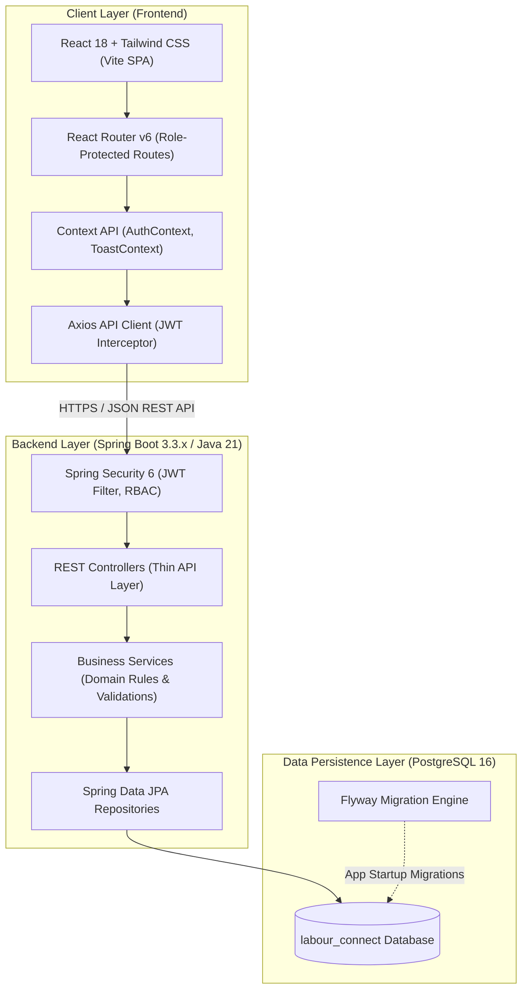
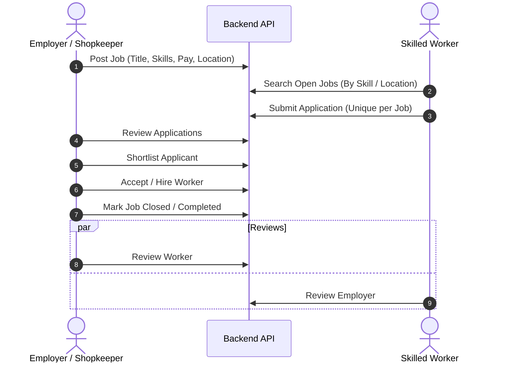
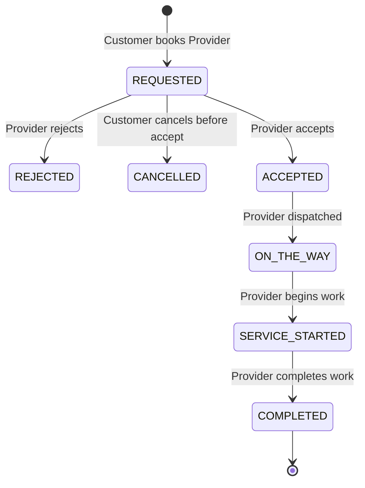

# Labour Connect — System Architecture & Design Specification

## 1. System Overview
**Labour Connect** is an integrated full-stack digital platform connecting daily wage / skilled workers, employers / shopkeepers, service providers, customers, and administrative personnel across two distinct operational modules:
1. **Employment Connect**: Matches skilled and wage workers with short-term, contractual, or permanent jobs posted by employers/shopkeepers.
2. **On-Demand Service Connect**: Facilitates immediate or scheduled hiring of local service providers (plumbers, electricians, carpenters, mechanics, etc.) by nearby customers.

---

## 2. Platform Modules & Actors

### The 5 Principal Roles
1. **ADMIN (`ROLE_ADMIN`)**:
   - Platform administration, category configuration, provider verification review, complaint mediation, user management, and audit inspection.
2. **EMPLOYER / SHOPKEEPER (`ROLE_EMPLOYER`)**:
   - Manage business profile, post jobs, filter workers, review applications, shortlist and hire workers, close jobs, rate workers.
3. **WORKER (`ROLE_WORKER`)**:
   - Manage worker profile (skills, expected pay, availability, location), discover jobs, apply for open positions, track applications, review employers.
4. **CUSTOMER (`ROLE_CUSTOMER`)**:
   - Discover verified service providers by category and proximity, create service requests, track service progress, rate completed work, file complaints.
5. **SERVICE PROVIDER (`ROLE_PROVIDER`)**:
   - Manage profile (skills, service areas, indicative pricing), submit documents for administrative verification, accept/reject incoming requests, progress request statuses, view reviews.

---

## 3. High-Level Workflows

### Employment Connect Workflow

### On-Demand Service Connect Workflow

---

## 4. Layered Backend Design
The backend follows strict separation of concerns:
- **`com.labourconnect.config`**: Security, CORS, Swagger OpenAPI, Jackson, Data Auditing configs.
- **`com.labourconnect.security`**: `JwtAuthenticationFilter`, `JwtTokenProvider`, UserDetails implementation, password encoders.
- **`com.labourconnect.controller`**: Thin REST endpoints with `@Valid` DTO parameters and `@PreAuthorize` annotations.
- **`com.labourconnect.service`**: Encapsulates all business rules, transactional boundaries (`@Transactional`), and cross-entity validations.
- **`com.labourconnect.repository`**: Spring Data JPA query interfaces with custom JPQL/native queries for distance and filtering.
- **`com.labourconnect.entity`**: Normalized JPA domain entities with auditing timestamps, constraints, and relationship mappings.
- **`com.labourconnect.dto`**: Explicit request and response payloads, ensuring domain entities are never leaked directly to clients.
- **`com.labourconnect.mapper`**: Translators between entities and DTOs.
- **`com.labourconnect.exception`**: Global `@RestControllerAdvice` error handler generating RFC 7807 compliant error responses.

---

## 5. Technology Stack Decisions
- **Java 21 LTS**: Modern virtual threads capability, record types, pattern matching, enhanced security, high throughput.
- **Spring Boot 3.3.x**: Production-grade microservices and web framework with native Jakarta EE 10 support.
- **PostgreSQL 16**: ACID-compliant relational storage, powerful spatial/coordinate calculations, and full text search capability.
- **Flyway**: Deterministic, version-controlled SQL migrations executing on startup.
- **React 18 + Vite**: High-performance, fast-refresh frontend tooling.
- **Tailwind CSS**: Utility-first CSS ensuring a clean, accessible, responsive design system.
