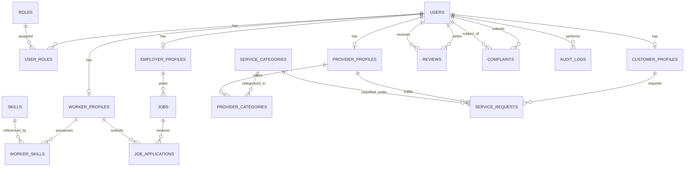

# Labour Connect — Database Design & Schema Specification

## 1. Relational Design Principles
The `labour_connect` database is designed according to Third Normal Form (3NF) principles with strict referential integrity, check constraints, foreign keys, and indexes for high query performance.

Key design criteria:
- **UUID / BIGSERIAL Identifiers**: Entities use auto-incrementing `BIGSERIAL` primary keys.
- **Audit Columns**: Every table maintains `created_at` and `updated_at` with automated timestamping.
- **Enforced Constraints**: Business invariants (e.g. valid statuses, rating ranges 1–5, unique job applications) are enforced at the database layer.
- **Soft Delete / Account Status**: User accounts maintain `is_active` and `is_suspended` flags rather than destructive deletes.

---

## 2. Entity-Relationship Overview

---

## 3. Table Definitions & Schemas

### Identity & Profiles
- `roles`: `id`, `name` (`ROLE_ADMIN`, `ROLE_EMPLOYER`, `ROLE_WORKER`, `ROLE_CUSTOMER`, `ROLE_PROVIDER`).
- `users`: `id`, `email` (unique), `password_hash`, `full_name`, `phone_number`, `is_active`, `is_suspended`, `suspension_reason`, `created_at`, `updated_at`.
- `user_roles`: `user_id`, `role_id` (Composite PK).
- `skills`: `id`, `name` (unique), `category`, `description`.
- `worker_profiles`: `id`, `user_id` (FK unique), `headline`, `bio`, `years_of_experience`, `daily_rate`, `hourly_rate`, `city`, `area`, `latitude`, `longitude`, `availability_status` (`AVAILABLE`, `BUSY`, `UNAVAILABLE`).
- `worker_skills`: `worker_id`, `skill_id` (Composite PK).
- `employer_profiles`: `id`, `user_id` (FK unique), `company_name`, `business_type` (`INDIVIDUAL`, `SHOPKEEPER`, `CONTRACTOR`, `ENTERPRISE`), `address`, `city`, `contact_person`, `phone`.
- `customer_profiles`: `id`, `user_id` (FK unique), `address`, `city`, `area`, `latitude`, `longitude`.
- `provider_profiles`: `id`, `user_id` (FK unique), `business_name`, `bio`, `years_of_experience`, `base_rate`, `hourly_rate`, `city`, `service_area_radius_km`, `latitude`, `longitude`, `verification_status` (`PENDING`, `APPROVED`, `REJECTED`), `verification_notes`, `verified_at`, `is_available`.
- `service_categories`: `id`, `name` (unique), `slug`, `icon_name`, `description`, `is_active`.
- `provider_categories`: `provider_id`, `category_id` (Composite PK).

### Employment Connect
- `jobs`: `id`, `employer_id` (FK), `title`, `description`, `job_type` (`FULL_TIME`, `PART_TIME`, `CONTRACT`, `DAILY_WAGE`), `daily_wage`, `estimated_days`, `city`, `area`, `latitude`, `longitude`, `status` (`OPEN`, `IN_PROGRESS`, `CLOSED`, `CANCELLED`), `created_at`, `updated_at`.
- `job_required_skills`: `job_id`, `skill_id` (Composite PK).
- `job_applications`: `id`, `job_id` (FK), `worker_id` (FK), `cover_note`, `bid_amount`, `status` (`APPLIED`, `UNDER_REVIEW`, `SHORTLISTED`, `ACCEPTED`, `REJECTED`, `WITHDRAWN`), `created_at`, `updated_at`.
  - *Unique Constraint*: `UNIQUE(job_id, worker_id)` — strictly prevents duplicate applications.

### On-Demand Service Connect
- `service_requests`: `id`, `customer_id` (FK), `provider_id` (FK), `category_id` (FK), `title`, `description`, `service_address`, `city`, `latitude`, `longitude`, `scheduled_at`, `estimated_cost`, `final_cost`, `status` (`REQUESTED`, `ACCEPTED`, `ON_THE_WAY`, `SERVICE_STARTED`, `COMPLETED`, `REJECTED`, `CANCELLED`), `rejection_reason`, `cancellation_reason`, `created_at`, `updated_at`.

### Trust, Reviews & Complaints
- `reviews`: `id`, `reviewer_id` (FK), `reviewee_id` (FK), `job_id` (FK nullable), `service_request_id` (FK nullable), `rating` (CHECK 1 <= rating <= 5), `review_text`, `created_at`.
  - *Unique Constraints*:
    - `UNIQUE(reviewer_id, job_id)` (one review per job)
    - `UNIQUE(reviewer_id, service_request_id)` (one review per service request)
- `complaints`: `id`, `complainant_id` (FK), `reported_user_id` (FK), `service_request_id` (FK nullable), `job_id` (FK nullable), `subject`, `description`, `status` (`PENDING`, `INVESTIGATING`, `RESOLVED`, `DISMISSED`), `admin_resolution_notes`, `resolved_by_admin_id` (FK nullable), `created_at`, `updated_at`.
- `audit_logs`: `id`, `user_id` (FK nullable), `action`, `entity_name`, `entity_id`, `details`, `ip_address`, `created_at`.

---

## 4. Indexing Strategy
To ensure query response times remain fast under high load:
1. `idx_jobs_status_city`: `(status, city)` for filtered job searches.
2. `idx_worker_profiles_city_avail`: `(city, availability_status)` for quick worker matching.
3. `idx_provider_profiles_verif_avail`: `(verification_status, is_available)` for active provider search.
4. `idx_service_requests_status`: `(status, provider_id)` and `(status, customer_id)` for dashboard activity feeds.
5. `idx_reviews_reviewee`: `(reviewee_id)` for computing aggregate ratings.
